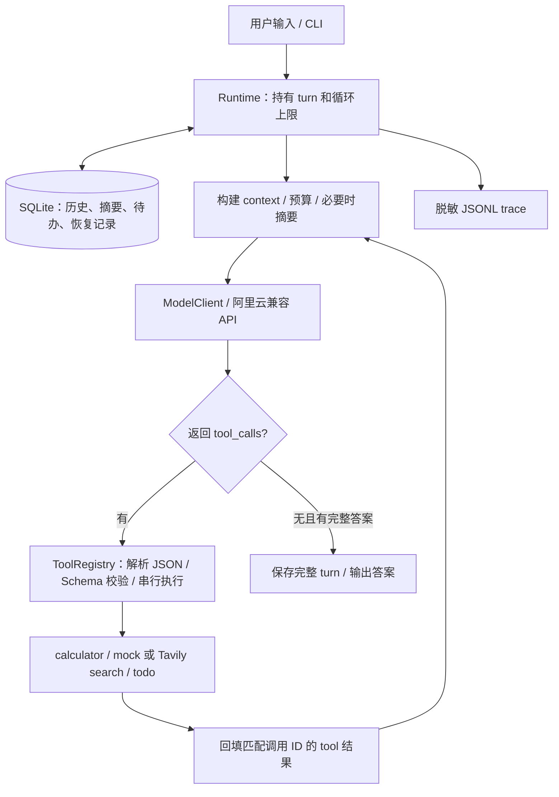

# 最小 Agent

一个用于学习 Agent 运行原理的 Python 命令行项目：直接调用 Qwen 的 OpenAI 兼容接口，自行实现工具循环、SQLite session 隔离和长对话压缩，不依赖 Agent 框架。

当前支持普通对话、calculator 四则运算、mock/Tavily 搜索、持久 todo、基础 session memory，以及 Issue #7 的异常恢复和 JSONL 执行日志。同步、非流式；模型显式返回的行动说明可以出现在 trace 中，但不读取或展示隐藏推理。

最终验收入口：[Issue #8 验收报告与逐项矩阵](docs/acceptance.md)、[实际开发与运行时 Prompt](docs/prompts.md)。下文 #6/#7 的测试计数和状态是历史记录，当前结果以验收报告为准。#8 的新增材料在本地分支 `codex/issue-8-acceptance`，尚未推送；等待用户审阅，不自动关闭总规格或合并 main。

已发布且本轮核对可访问的[代码基线 e439144](https://github.com/Nuru-Banmian/minimal-agent/tree/e43914454e26b4eba0fbd6561043148412d5280c)包含 #7。GitHub main 当前仍为 #6 合并版本；以上链接不代表 #8 已发布。

## 安装与启动

需要 Python 3.11+。在项目根目录的 PowerShell 执行（已有 `.venv` 时跳过创建）：

首次下载可执行以下命令；该远程分支提供 #7 基线。#8 新增验收文件发布前，请在本地交付分支使用它们。

```powershell
git clone --branch codex/recovery-trace https://github.com/Nuru-Banmian/minimal-agent.git
Set-Location minimal-agent
```

```powershell
py -3.13 -m venv .venv
.\.venv\Scripts\python.exe -m pip install -e '.[dev]'
if (-not (Test-Path .env)) { Copy-Item .env.example .env }
```

编辑 `.env`，填写 `LLM_BASE_URL`、`DASHSCOPE_API_KEY`，核对 `LLM_MODEL`。地址从账号控制台获取，应包含 API 版本路径，不包含 `/chat/completions`，且与密钥地域、业务空间匹配。API 参数参考[阿里云官方接口文档](https://help.aliyun.com/zh/model-studio/qwen-api-via-openai-chat-completions)。不要提交密钥。

```powershell
.\start.bat --user-id demo --session-id work
```

Windows 可以双击 `start.bat`，默认打开 `local/default`。脚本自动进入项目目录，以 `.venv` 和 UTF-8 启动。也可以直接运行：

```powershell
.\.venv\Scripts\python.exe -X utf8 -m minimal_agent --user-id demo --session-id work
```

Linux/macOS 使用 `python3 -m venv .venv`、`.venv/bin/python -m pip install -e '.[dev]'` 和 `.venv/bin/python -m minimal_agent`。实际运行验证在 Windows 完成。

程序只加载**当前工作目录**的 `.env`，已有环境变量优先（包括显式空值），不展开变量引用。`start.bat` 会先切到项目根目录。

## 试一轮对话

```text
我叫小林，项目代号是青竹，周五交报告，不安排周末工作。
12 加 8，再将结果乘以 3。
给我加一个提交青竹报告的待办。
列出我的待办。
把提交青竹报告那一项完成。
/exit
```

用同一启动命令重新进入，再问“我叫什么，哪天交报告？”即可恢复该 session。另开终端时使用不同 `--session-id`，其消息、摘要和待办独立。

- 空输入跳过；`/exit`、`/quit`、EOF 或 Ctrl+C 退出。
- `--db` 指定 SQLite 文件，默认当前目录 `agent.sqlite3`；`:memory:` 仅用于临时演示，退出即消失。
- 同一 session 同时只允许一个运行者，第二个终端会报告占用；退出或进程结束后操作系统释放锁。
- `user_id` 是本地命名空间，**不是认证**。能够访问数据库并知道标识的人可以读取对应会话。

## 工具

| 工具 | 行为 |
| --- | --- |
| `calculator` | add/subtract/multiply/divide，校验数值参数，不执行任意表达式代码 |
| `search` | 默认 mock；可选 Tavily 联网搜索，返回来源与摘要 |
| `todo` | add/list/complete；应用注入当前身份，模型不能指定其他 user/session |

mock 搜索只有固定的 **2026-09-01 上海小雨、22–27°C、建议带伞** 教学资料。输入“查上海的示例天气，帮我记一个带伞的待办”。回复必须说明模拟、非实时；无命中与搜索失败分别报告。

要联网搜索，配置：

```dotenv
SEARCH_PROVIDER=tavily
TAVILY_API_KEY=你的密钥
```

再运行 `.\start.bat --search-provider tavily`，输入“搜索 Python 官方文档并添加一个阅读文档的待办，回答附来源链接”。命令行参数覆盖环境配置；`--search-provider mock` 切回模拟。缺少 Tavily 密钥会报错，不自动退回 mock。

Tavily 请求使用 basic 模式、最多 5 条结果，不请求全文或服务商生成的答案；10 秒 HTTP 阶段超时、响应体上限 1 MB，标题/摘要分别最多 300/2000 字符并标记裁剪。网页内容是外部资料，不能更改工具权限。联网结果也不保证实时。

完成待办前模型需 list 当前 ID；目标缺失或歧义时先澄清。SQL 强制身份隔离，complete 重复执行返回 already_completed，未知 ID 返回 not_found。自然语言歧义识别依赖模型；没有宣称其永远准确。

## 一次 turn 如何运行



`default_registry` 用名称、描述、JSON Schema 和 Python callable 注册工具，Schema 经 `definitions()` 发给模型。`ModelClient` 转换原生 `tool_calls`，保留调用 ID、函数名与 JSON arguments；注册表拒绝未知工具、畸形 JSON 与不合 Schema 的参数，再调用 Python 函数。模型通过工具结果继续决定下一步，不使用输入关键词分支代替模型决策。todo 的身份与执行键由应用注入，模型不能传入别人的 user/session。

每条用户输入是一个 turn；其中每次主模型请求是一个 step，默认最多 8 次。执行顺序：

1. 从 SQLite 读取当前 session 摘要与未覆盖的完整历史，准备 context。
2. 检查预算；必要时用一次独立模型请求摘要旧的完整 turn。
3. 将 system、历史摘要、近期消息、当前输入和工具 Schema 发送给模型。
4. 若返回 tool_calls，校验参数并按顺序执行，将带匹配 tool_call_id 的结果放回 context。下一次请求前再次检查预算。
5. 无 tool_calls 且有完整文本答案时结束，将当前 turn 的原始消息在事务中保存。

有 content 且有 tool_calls 时，content 只是行动说明，不能提前当成最终答案。工具错误可以让模型在剩余 steps 内纠正。默认最多 **8 次主请求 + 1 次摘要请求**，不自动重试整个 turn，HTTP transport 显式设为零重试。`--max-steps` 调整主请求上限；超时约束每次 HTTP 阶段的等待，步数限制纠错循环，两者不是整轮墙钟截止时间。

CLI 同时输出控制台 trace 和本地 `logs/trace.jsonl`，可用 `--trace-file` 指定路径。日志包含 user/session、跨重启唯一的 turn_id、进程内 turn 序号、step、tool_call_id、UTC 时间、事件状态、累计耗时和实际模型请求数 `actual_requests`。最终 stop 给出本轮总数（包含摘要、失败的请求）；model_request 是即将尝试请求的事件，不能把日志写入失败前的此事件当成已发送请求。搜索 HTTP 归入工具执行，不属于模型请求预算。

事件包括 model_request/model_response、可选 action、tool_start/tool、stop、memory_compacted、recovery/recovered_tool。tool 的 `replayed` 区分重复写调用返回缓存与新执行；压缩事件记录 before_bytes/after_bytes。即使模型 content 为空也有完整调用日志。日志对配置密钥和认证字段脱敏，每个大字段最多保留 2048 字节预览，并附 truncated/original_bytes；原始参数和结果仍可保存在本地 SQLite。直接使用 Runtime 并配置其他服务密钥时，通过 `trace_secrets` 提供这些值以供脱敏。无法写日志时 CLI 明确报错并保留接收输入的能力。

## Memory：保存什么，什么时候召回

| 信息 | 存储 | 召回时机 | 放入 context 的位置与取舍 |
| --- | --- | --- | --- |
| 应用指令 | Runtime 代码 | 每次请求 | 最前面的 system；不从摘要生成 |
| 完整历史（含已修复的中断轮） | SQLite `messages` | 每 turn 读取摘要边界之后的消息 | 保留近期完整 turn；已覆盖原文不再发送，但仍存数据库 |
| 旧对话摘要 | SQLite `memories`，含 covered 序号 | 每 turn，按 user/session 读取 | system 后的 **user 历史资料消息**；不授予 system 权限 |
| 结构化待办 | SQLite `todos` | 模型调用 todo 时 | 作为 tool 结果返回；不自动读取所有 session 或整库待办 |
| 当前 turn | 运行内存，成功后保存 | 当前工具循环持续使用 | 始终保留，不能被摘要；调用与结果成对 |

默认数据库位于启动目录，`start.bat` 启动时即项目根目录；三个表共用同一 SQLite 文件。消息、摘要、待办均按 `(user_id, session_id)` 隔离。数据库明文保存数据，`.locks` 相邻目录保存占用锁文件；不要在运行时删除锁文件或使用硬链接别名绕过锁。本方案面向本机文件系统。

摘要只覆盖较旧的**完整 turn**。默认至少保留最近 2 个完整 turn，不拆开 assistant tool_calls 和 tool 结果。压缩输入包含旧摘要及新增的旧 turn；当前问题和当前工具循环不进入摘要。摘要须为非空文本、无工具调用且在字节上限内，并且新 context 能装下，才事务更新摘要与覆盖边界。重启后从边界继续，不重复摘要已覆盖内容。

若在工具循环中才超预算，且本轮尚未摘要，仍可压缩已存储的旧 turn；最多一次，不压缩当前 turn。大工具结果在进入 context 前转换为带 `truncated: true` 和 `preview` 的有界 JSON。数据库保留**裁剪前**的工具结果；旧工具结果召回与摘要前也经过裁剪。预览可能不含完整 ID 或全部条目，不能当作完整清单。

简单摘要可能遗漏细节、时间关系或精确措辞；多次摘要还会累积误差。它没有全文检索或自动找回已覆盖原文的能力，重要事实应由用户复核，待办状态应以 todo 为准。大量待办超过裁剪限额时也可能无法靠当前 list 接口完整处理；本步未增加分页或向量检索。

## 预算与配置

**这里的输入预算是 UTF-8 字节近似，不是精确 token 计数。** 主请求判定公式：

```text
UTF8字节数(JSON紧凑序列化({messages, tools})) + 4 × MEMORY_OUTPUT_TOKENS
    <= MEMORY_CONTEXT_BYTES
```

messages 已包含 system、摘要、近期完整消息与当前工具循环，tools 是全部工具 Schema。`4 × 输出 token` 是工程预留比例，不是 tokenizer 换算保证；阈值需按所选模型保守设置。主请求和摘要请求都发送 `max_tokens` 限制输出，服务商的真实 token 窗口仍可能拒绝请求。

| 环境变量 | 默认 | 含义 |
| --- | --- | --- |
| `LLM_MODEL` | 示例 qwen-plus | 必填模型名 |
| `LLM_BASE_URL` | 无 | 必填兼容 API 根地址 |
| `DASHSCOPE_API_KEY` | 无 | 必填模型密钥 |
| `LLM_TIMEOUT_SECONDS` | 30 | 主模型 HTTP 各阶段超时秒数 |
| `SEARCH_PROVIDER` | mock | mock 或 tavily |
| `TAVILY_API_KEY` | 无 | 仅 tavily 必填 |
| `MEMORY_CONTEXT_BYTES` | 64000 | 主请求预算，含输出预留 |
| `MEMORY_OUTPUT_TOKENS` | 1024 | 主请求与摘要请求的 max_tokens |
| `MEMORY_KEEP_RECENT_TURNS` | 2 | 不参与摘要的最近完整 turn 数，至少 1 |
| `MEMORY_SUMMARY_BYTES` | 4096 | 摘要文本 UTF-8 字节上限 |
| `MEMORY_SUMMARY_INPUT_BYTES` | 256000 | 摘要请求 messages 序列化的独立输入上限，另有输出 token 上限 |
| `MEMORY_SUMMARY_TIMEOUT_SECONDS` | 15 | 摘要 HTTP 各阶段独立超时，不是整个请求的绝对总时限 |
| `MEMORY_TOOL_RESULT_BYTES` | 8000 | 单条 tool content 字节上限，含裁剪标记，最小 64 |

所有整数配置必须为正数，context 必须大于输出预留；超时必须为正有限数。CLI 从环境读取，代码调用可传 `Runtime(..., memory=MemorySettings(...))`。

## 失败如何处理

配置错误退出码 2。模型鉴权、限流、网络、超时或协议错误给出安全提示，CLI 可继续输入。摘要失败、空摘要、过长摘要或压缩后仍超预算时，旧摘要/边界和原始历史不被更新；不静默丢弃用户问题，也不自动重试。

当前输入、Schema、保留的近期 turn 或工具循环不可缩减时明确报“过长”；缩短请求、调整预算或换 session 后再尝试。摘要输入超过独立预算也明确报错。本轮如果已经成功更新摘要，但后续模型失败，该有效摘要可以保留，原始历史仍在。

没有工具调用的失败轮不写消息历史。有工具调用时，在派发前保存 pending_turns 意图，每次工具结束后保存已知结果；下一次输入（也可以重启后）恢复未完成轮，补齐匹配 ID 的中断结果与应用结束说明，随后才发送合法的历史给模型。不自动重放整个 turn，也不声称部分成功的工具全部回滚或全部成功。

todo 写操作及其结果在同一 SQLite 事务中提交，以应用分配的 user/session/turn_id/tool_call_id 为键。同一调用重放返回原结果，不重复添加；同一 ID 改参数返回 call_id_conflict。用户主动的新请求使用新的 turn_id，仍可以添加相同内容；list 总是读取当前状态。事务提交后、历史检查点写入前中断时，可从 tool_results 恢复准确结果；没有已提交结果的调用明确标记 interrupted，不猜测成功。请先查询状态再主动重试。正常退出码 0 只代表进程正常结束，不代表期间每一轮都成功。

错误分类：API 为 authentication、rate_limit、timeout、network、empty_response、protocol_error、api_error；参数保留 invalid_arguments 并以 category 区分 malformed_json/schema_mismatch；工具为 unknown_tool、invalid_calculation、tool_exception、database_error 或搜索专用错误。可恢复工具错误返回模型继续纠正；API、预算或历史存储失败由应用结束本轮，CLI 解释后继续接收输入。

## 测试与真实演示

默认离线测试通过本机回环 HTTP 脚本化外部模型响应，使用真实 Runtime、CLI、SQLite 和 calculator/todo。联网搜索的离线测试仅替换外部搜索 HTTP，不能视为真实 Tavily 验收。

```powershell
.\.venv\Scripts\python.exe -m pytest -q
.\.venv\Scripts\python.exe -m mypy
.\.venv\Scripts\python.exe -m ruff check .
.\.venv\Scripts\python.exe -m ruff format --check .
git diff --check
```

运行前确保没有遗留的 `RUN_LIVE_API` 或 `RUN_LIVE_SEARCH` 环境变量。真实长对话演示显式启用，使用临时数据库，不修改已有待办：

```powershell
$env:RUN_LIVE_API = '1'
try {
    .\.venv\Scripts\python.exe -X utf8 -m pytest tests/test_live_memory.py -q -s --tb=short
} finally {
    Remove-Item Env:RUN_LIVE_API -ErrorAction SilentlyContinue
}
```

演示使用真实 Qwen API、Runtime 与 todo，逐轮重新打开 session，加入长背景触发压缩，再追问“小林/青竹/周五/周末约束”，查询并完成原待办。它验证关闭重开 Runtime 的恢复；独立 CLI 子进程恢复另有既有 session 测试。本测试不调用搜索服务。其输出含实际测试 Prompt 和 trace，不含密钥。

| Issue #6 验收项 | 证据 |
| --- | --- |
| 可调预算、读取 memory、近期保留、重启不重复摘要 | `test_compression_restores_summary_and_recent_turn_after_restart` |
| 完整工具配对、失败/空/超长/超时、最多一次摘要 | `test_failed_summary_keeps_all_history_and_only_attempts_once` |
| user/session 摘要隔离 | `test_summary_isolated_by_user_and_session` |
| 工具裁剪标记、原始工具历史保留 | `test_large_tool_result_is_bounded_but_raw_history_survives` |
| 当前输入过长、近期不可缩减、摘要独立预算 | CLI 过长测试和 `test_irreducible_context_reports_error_without_committing_summary` |
| 当前 turn 不摘要，工具增长可压缩旧 turn | `test_current_tool_turn_is_not_compressed_on_overflow`、`test_tool_growth_can_compress_old_turns_once_without_splitting_current` |
| 压缩后的事实追问和 todo 操作 | `tests/test_live_memory.py`，真实 API 记录见下 |
| 存储、召回位置、信息取舍及局限 | 本 README 的 Memory 和预算章节 |

其他真实测试：`tests/test_live.py`（模型、CLI、calculator、session、mock search/todo）；`tests/test_live_search.py` 使用 `RUN_LIVE_SEARCH=1` 验证真实 Tavily。只执行与此次改动相关的真实演示；未运行项不能算作此次通过。

## 本次开发记录与代码导读

实际用户 Prompt：`[$implement](C:\Users\1\.agents\skills\implement\SKILL.md) #6`，随后确认 Runtime.run/CLI 测试边界及审阅基点 `240eaa1f3b0606a48a92d4b958998f3fea2efe8d`，追加“做完后readme重写一下”。Issue #5 开始时已关闭，本次使用独立分支 `codex/session-memory`。既有未跟踪 CONTEXT.md 保留，不纳入提交。

TDD 先观察缺少 memory 模块的失败，再实现压缩/重启；工具原始结果超过 400 字节的测试失败后增加 context 投影；CLI 忽略 MEMORY_CONTEXT_BYTES 的测试失败后接入环境配置。首次真实演示通过事实追问，但 todo 工具结果使 context 超预算，导致失败；增加“本轮尚未摘要时可压缩旧 turn”的回归测试并修复，仍不拆开当前调用与结果。Ruff 提示导入/格式问题后统一调整，mypy 检查源文件类型。

- [首次真实运行记录](docs/evidence/issue-6-live-first-attempt.txt)：如实保留失败。
- [后续真实运行记录](docs/evidence/issue-6-live.txt)：真实模型输出及测试结果。
- [旧步骤开发与验收档案](docs/development-history.md)：重写前 README 原文，仅作为当时记录，其中阶段描述、计数和状态不代表当前实现。

阅读顺序：`cli.py` 输入输出 → `runtime.py` turn/step 与压缩决策 → `memory.py` 字节预算及 context 投影 → `sessions.py` SQLite/占用锁 → `tools.py` 注册与执行 → `client.py` HTTP 协议。`config.py` 加载模型配置，`search.py` 实现模拟/联网搜索。

以上为 Issue #6 当时的开发记录；开始 #7 时已读取确认 #6 关闭。

真实验收：2026-09-08 10:43:10 UTC 开始，qwen-plus，1 passed in 21.78s。首次运行 1 failed in 14.53s，失败点和修复见上，未记为通过。

本次全量离线结果：**138 passed, 8 skipped in 67.80s**；8 项需显式开启的真实测试默认跳过，本步真实 memory 演示已单独通过。mypy 检查 10 个源文件通过，Ruff 检查及全部 29 个 Python 文件格式检查通过，`git diff --check` 通过。

双轴只读审阅范围：`git diff 240eaa1f3b0606a48a92d4b958998f3fea2efe8d...6dfbed2`。Standards：0 项规范违反或需修改的代码异味；Spec：0 项缺失、范围外或错误实现。两个子代理分别核对规范与 Issue #6/#1，审阅后仅补充本段验证记录。

## Issue #7 开发与验收记录

实际用户 Prompt：`[$implement](C:\Users\1\.agents\skills\implement\SKILL.md) #7`；随后用户回复“同意”，确认 Runtime.run/CLI 测试边界和审阅基线 `04770a454bfa06eb5ec56df3bf0c8abb549b6313`。分支为 `codex/recovery-trace`，未跟踪 CONTEXT.md 保留。实现使用现有 Runtime 和 default_registry，不另建执行循环。

实际 TDD 过程：先观察普通工具异常和数据库异常逃逸，再补结构化结果；观察重复 add 生成不同 ID，再将写入与结果记录放入事务；观察中断后恢复历史为空，再增加检查点及配对修复。随后故障测试发现缺少错误分类和日志文件参数，逐项补齐。脱敏测试发现 Authorization 的 Bearer 值泄漏，修正后回归；重复 list ID 返回旧结果的回归失败后，将只读查询排除在写操作缓存外。两项旧测试的“丢弃失败工具轮”断言与本期恢复要求冲突，已改为验证保留结果和中断标记。

| #7 验收项 | 公共边界证据 |
| --- | --- |
| API 分类、超时、禁用重试、失败后可继续 | `test_api_failure_trace_counts_attempt_and_next_turn`、`test_transport_failures_are_counted_without_retry_and_next_turn_works`；既有 CLI 超时/鉴权测试 |
| 畸形 JSON、Schema、未知工具、工具/数据库异常和部分成功 | `test_argument_errors_are_distinguished_and_correctable`、`test_tool_failure_keeps_success_and_can_continue`、既有 Runtime 多工具测试 |
| 纠错受上限约束、下一轮可继续 | `test_cli_step_limit_trace_and_followup`、既有默认 8 步测试 |
| 同次写重放幂等、重启后新请求仍能写入、ID 改参拒绝 | `test_replayed_todo_is_once_per_turn_but_new_request_can_add`、`test_reused_write_id_cannot_change_arguments` |
| 事务结果与恢复，不盲目重放 | `test_database_fault_never_duplicates_or_loses_committed_todo`、`test_restart_repairs_interrupted_calls_without_replaying_writes` |
| JSONL、身份/调用/耗时/状态/停止原因、空行动说明 | `test_cli_jsonl_trace_is_bounded_redacted_and_complete` |
| 摘要实际请求计数与压缩大小 | `test_summary_trace_counts_actual_requests_and_compression` |
| 有界参数/结果、脱敏 | JSONL 测试、`test_large_result_log_redacts_authentication_and_bounds_preview`、搜索大结果测试；日志与模型 context 采用独立限额 |
| 离线失败恢复与上限演示 | `examples/offline_recovery.py`，运行证据见下 |

离线演示不需要外部 API，使用真实 CLI、临时 SQLite、回环 HTTP 脚本化模型及未知工具错误：

```powershell
.\.venv\Scripts\python.exe -X utf8 examples/offline_recovery.py
```

输入依次为“故障注入”“继续”“达到上限”。脚本自动验证 stop 请求数为 1、1、2，并打印可解释原因的 trace。运行记录：[issue-7-offline.txt](docs/evidence/issue-7-offline.txt)。本期未运行真实 Qwen/Tavily API；不得把离线结果或 #6 的真实运行记录当成本期真实 API 验收。Issue #7 保持打开等待用户审阅，不自动进入下一步。

首次全量结果为 2 failed、154 passed、8 skipped（76.74s）：空响应新文案不满足既有完整回答提示断言；搜索测试原来直接从 trace 读取完整大结果。已保留兼容文案，并将搜索数据验收移到实际发给模型的 HTTP 消息，同时验证 trace 截断。规格审阅还复现 Basic 认证头仅遮住方案名、未遮凭据的问题，增加 Runtime 公共日志回归后修复；后续专项测试为 **20 passed in 9.62s**。证据文件统一为 UTF-8/LF，避免 PowerShell 输出的 CRLF 被 diff 检查标为尾随空白。

最终验证（2026-09-08）：**158 passed, 8 skipped in 76.13s**；显式关闭 RUN_LIVE_API/RUN_LIVE_SEARCH 后执行全量，8 项真实测试按设计跳过。mypy 检查 11 个源文件通过；Ruff 检查通过，32 个 Python 文件格式检查通过，`git diff --check` 通过。离线演示退出码 0。

双轴审阅使用 `git diff 04770a454bfa06eb5ec56df3bf0c8abb549b6313...bf2972666e54b6e54b09df3774443360c98c9bbb`。Standards：0 项规范违反或需修改的代码异味。Spec：首次发现 1 项 Basic 脱敏缺陷，修复后的独立复核为 0 项未解决；复核另运行 3 项聚焦测试通过（17 deselected，1.75s）。模型请求计数口径已在本 README 说明。审阅后只补充本文验收记录，未继续下一 Issue，未推送或合并。
